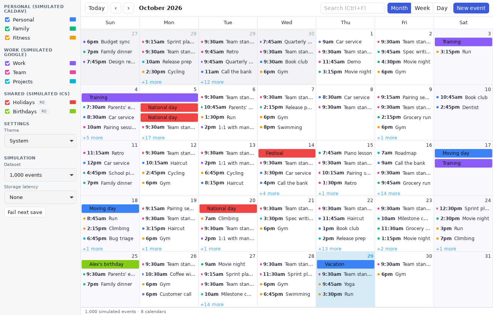
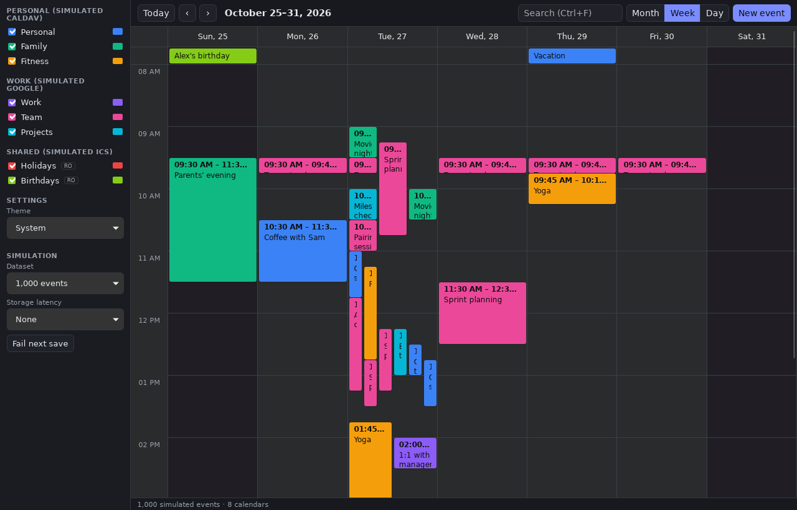
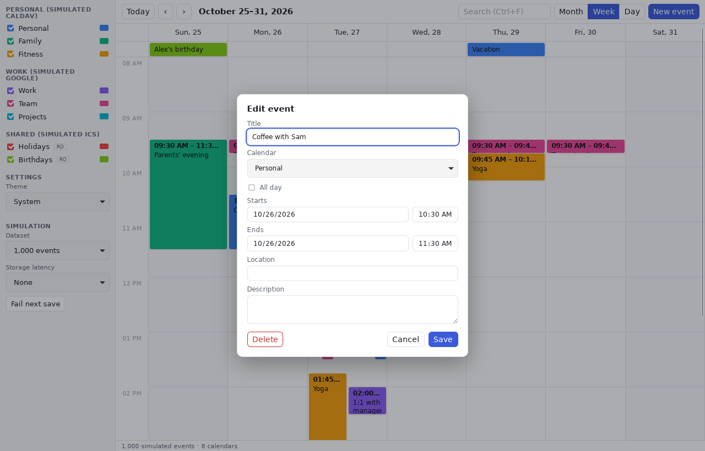

# Universal Calendar

A fast, local-first, free and open-source desktop calendar for Linux (KDE Plasma first), designed to unify CalDAV, Google Calendar, Microsoft 365 and ICS subscriptions behind one responsive interface. The app needs no hosted backend, telemetry or developer-run account.

> **Status: Milestone 2 (Rust calendar core and SQLite).**
> Events, settings and calendar colours are stored locally in SQLite, and
> recurring events are expanded by the Rust core. Data is still simulated
> (no calendar providers are connected yet). See [Roadmap](#roadmap).



| Week view, dark theme | Event editor |
|---|---|
|  |  |

## Features

- Tauri 2 desktop shell with a Svelte 5 + TypeScript (strict) + Vite frontend.
- Month, week and day views powered by the MIT-licensed [SVAR Svelte Calendar](https://github.com/svar-widgets/calendar), kept behind an adapter so it can be replaced.
- Multiple simulated accounts and calendars, including read-only ones. Each calendar has a colour picker and a visibility toggle.
- Event creation and editing (click, drag-to-create, or **N**), drag/resize to move events, and timed and all-day events.
- **Local persistence** in SQLite (WAL, migrations). Events, calendar colours, hidden calendars, theme and dataset choice survive restarts. The database lives at `~/.local/share/org.universalcalendar.desktop/calendar.db`.
- **Recurring events** (RRULE, RDATE, EXDATE, moved occurrences) expanded by the Rust core for the visible range only, time-zone and DST correct:
  - **Dragging** an occurrence moves just that one.
  - **The editor** edits the whole series and offers *Delete this event* or *Delete series*.
  - **Repeat presets:** daily, weekdays, weekly, monthly, yearly. Custom rules are kept.
- Optimistic updates. A failed save is rolled back with a visible message.
- Visible-range loading with adjacent-month prefetch and cancellation of obsolete loads.
- Debounced search over loaded events.
- Light and dark themes that follow the system preference.
- Keyboard shortcuts:

  | Key | Action |
  |---|---|
  | `T` | Today |
  | `N` | New event |
  | `M` / `W` / `D` | Month / week / day view |
  | `J` / `K` | Next / previous |
  | `Ctrl+F` | Search |
  | `Esc` | Close dialog |
  | `Ctrl+Shift+P` | Toggle performance panel |

  Shortcuts don't fire while you're typing in a field.
- Deterministic data generator (100 / 1,000 / 5,000 events, written in Rust), a scripted UI benchmark that runs in the real WebKitGTK window, and a storage benchmark. See [docs/performance.md](docs/performance.md).
- On first run the app seeds 1,000 simulated events. **Choosing a dataset in the sidebar replaces all events.**

## Supported platforms

Linux (developed on Ubuntu 24.04; target desktop KDE Plasma). Windows and macOS are architecturally possible through Tauri but not yet built or tested.

## Prerequisites

- Rust stable ≥ 1.90 (`rustup`), with `rustfmt` and `clippy`
- Node.js ≥ 22 (tested with 26.13 LTS) and npm
- Tauri's Linux system libraries:

  ```sh
  sudo apt install pkg-config libwebkit2gtk-4.1-dev libssl-dev \
    libayatana-appindicator3-dev librsvg2-dev libxdo-dev file
  ```

- Optional, for headless screenshots and benchmarks: `xvfb xauth imagemagick`

## Build and run

```sh
cd apps/desktop
npm install
npx tauri dev          # development window with hot reload
npx tauri build        # release binary + .deb + AppImage under target/release/bundle/
```

You can also run the frontend alone in a browser. That preview uses an in-memory mock with **no persistence and no recurrence expansion**; it exists for quick UI work and for the latency and failure simulation controls:

```sh
cd apps/desktop
npm run dev            # http://localhost:1420
```

## Test and check

```sh
# Frontend (from apps/desktop)
npm run check          # svelte-check + strict TypeScript, warnings fail
npm test               # Vitest unit + component tests (runs with TZ=Europe/Berlin for DST coverage)
npm run build          # production bundle

# Rust (from the repository root)
cargo fmt --all -- --check
cargo clippy --workspace --all-targets --all-features -- -D warnings
cargo test --workspace --all-features
cargo build -p calendar-core -p calendar-storage   # the engine builds without Tauri
```

## Benchmark

```sh
(cd apps/desktop && npx tauri build)
python3 scripts/bench.py --label my-machine          # UI: 100/1,000/5,000 events + 30 s idle sample
cargo run --release -p calendar-storage --example bench_queries   # SQLite + recurrence query latency
scripts/screenshot.sh docs/screenshots/month.png     # optional
```

The UI benchmark uses a temporary database and never touches your calendar. Both scripts use Xvfb and a private D-Bus session automatically when no display is available. Results are written to `docs/benchmarks/`; methodology and current numbers are in [docs/performance.md](docs/performance.md).

## Repository layout

```text
crates/calendar-core/        Provider-neutral models, validation, recurrence, wire types, simulated data
crates/calendar-storage/     SQLite (SQLx) persistence, migrations, range queries
apps/desktop/src/            Svelte UI: components, stores, services, bench runner
apps/desktop/src-tauri/      Thin Tauri 2 shell: commands forward to the crates
docs/                        Architecture, performance, provider/sync design, decisions
scripts/                     Benchmark and screenshot tooling
```

See [docs/architecture.md](docs/architecture.md).

## Roadmap

1. Desktop foundation and performance prototype ✔
2. **Rust calendar core, SQLite storage, Tauri commands, recurrence** ← current
3. CalDAV (Nextcloud reference) with offline queue
4. Google Calendar and Microsoft Graph
5. Production quality: recurrence editing, notifications, agenda view, ICS subscriptions, packaging

## License

GPL-3.0-or-later. See [LICENSE](LICENSE). Third-party dependencies are under GPL-compatible permissive licenses; see [docs/decisions/dependencies.md](docs/decisions/dependencies.md).
