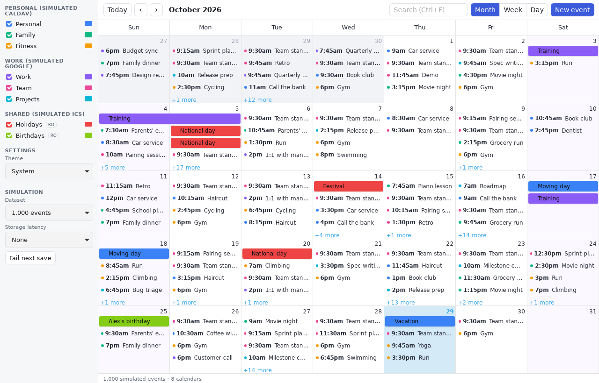
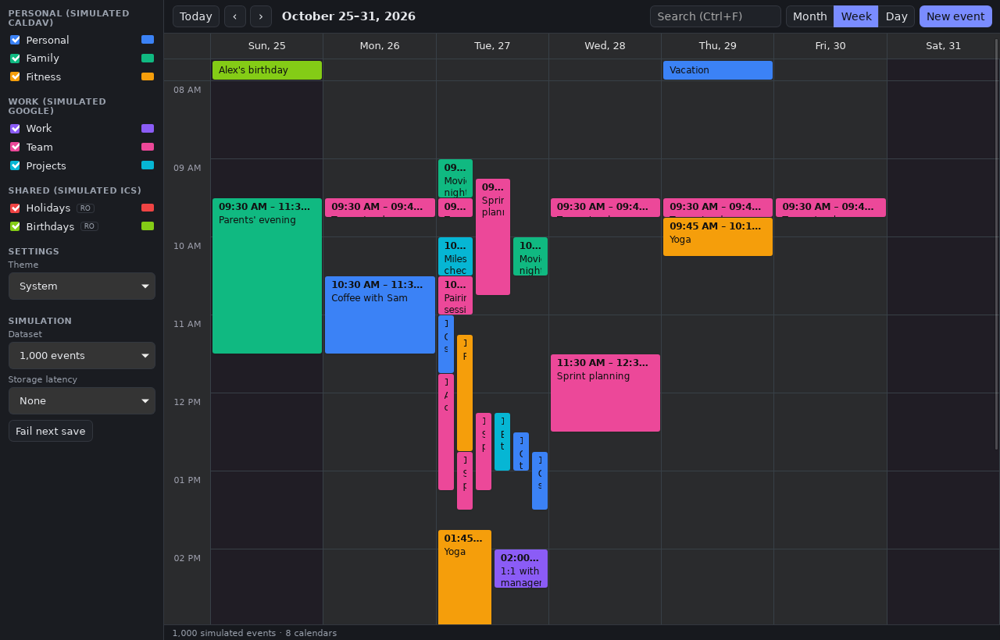
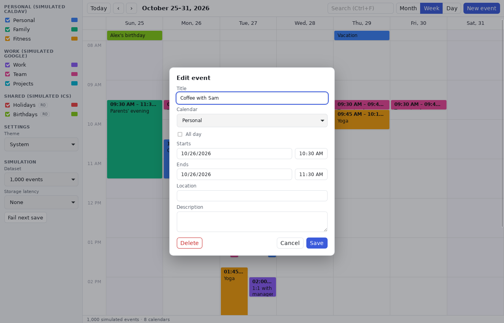

# Universal Calendar

A fast, local-first, free and open-source desktop calendar for Linux (KDE Plasma first), designed to unify CalDAV, Google Calendar, Microsoft 365 and ICS subscriptions behind one responsive interface. The app needs no hosted backend, telemetry or developer-run account.

> **Status: Milestone 5 (production quality) in progress.** Milestones 1–4 are complete.
> - **CalDAV** (Nextcloud, Fastmail, Radicale, Baïkal, …): syncs both ways with an offline queue, validated against Nextcloud.
> - **Google Calendar and Microsoft 365 / Outlook.com:** accounts sign in with OAuth and sync through the same engine. Both are tested against faithful API fakes, and Google also with a live account; Microsoft still needs a live check. Live use needs an OAuth client registration ([how](docs/provider-integration.md#registering-oauth-clients)).
> - Everything is stored locally in SQLite. A *Personal* calendar on this computer works without any account. See [Roadmap](#roadmap).



| Week view, dark theme | Event editor |
|---|---|
|  |  |

## Features

### CalDAV accounts

- **Add CalDAV account…** in Settings → Accounts: enter the server address (for Nextcloud, just `https://your.cloud`), the user name and an **app password**.
- **Discovery** follows the standard route (`/.well-known/caldav` → principal → calendar home). Every event calendar is listed with its server colour; shared read-only calendars are detected.
- **Two-way sync** in the background:
  - Every change is saved locally first, then uploaded with ETag checks, so another client's edits are never silently overwritten.
  - Server changes are fetched incrementally with sync tokens where supported (RFC 6578), falling back to an ETag comparison.
  - It syncs on start-up, a few seconds after local edits, every 5 minutes, and on **Sync now**.
- **Offline:**
  - Changes are queued in SQLite and survive restarts and crashes. A deletion stays queued even if it happens while the event's first upload is still in flight.
  - Failed uploads retry with backoff (30 s doubling to 1 h). An account whose sync fails (wrong password, server down) backs off as a whole instead of retrying in a loop; editing or **Sync now** tries again at once.
  - Settings → Accounts shows *Offline*, *N changes waiting* or errors. While an account needs attention, the bottom of the sidebar says so.
- **Conflicts and refused changes:**
  - **Changes to different fields merge automatically**, for example a new title here and a new location on the server. Cancelled occurrences from both sides combine.
  - An event whose same field was changed differently on both sides gets a dashed red outline. The editor offers *Keep mine* or *Use server version*, and **Compare versions** shows both side by side with the differences marked. Settings → Accounts → **Review…** lists every conflicting or refused change, including deletions (which have no event left to open). A refused change can be retried, still checked against the server's version.
- **Unknown data is preserved.** Properties this app doesn't edit (alarms, attendees, vendor `X-` fields, VTIMEZONEs) are written back as the server sent them, also when a whole series is moved. This is tested for the cases in `crates/calendar-ical/tests/events.rs`; it is not a guarantee for every possible object.
- **Untrusted server data** can't stop synchronization. An object that can't be read keeps its last good version, and Settings → Accounts counts it as *could not be read*. Objects shown only approximately (unknown time zone, "this and following" changes, RDATE periods) are counted too.
- **Credentials** are stored in the system keyring via the Secret Service API (KWallet on Plasma, GNOME Keyring elsewhere), never in the database or logs. They are only sent over HTTPS (plain HTTP is allowed for `localhost` test servers only), and never to a host outside the server's domain found during discovery.

### Google and Microsoft accounts

- **Add Google account…** / **Add Microsoft account…** in Settings → Accounts. You sign in in your web browser (OAuth with PKCE and a loopback redirect), so the app never sees your password. Tokens go to the system keyring and are refreshed automatically. If a sign-in expires or is revoked, **Sign in again…** appears and nothing queued is lost.
- **Both use the same engine as CalDAV:** offline queue, version-checked uploads, conflicts, and the **Review…** list. Several accounts per provider are supported, and each account syncs and fails independently.
- **Only what you change is sent.** Attendees, reminders, conferencing links and other details this app doesn't edit stay untouched.
- **Google:** full recurring-series support, with incremental sync via sync tokens.
- **Microsoft:** sync via calendar-view delta over a moving window (12 months back, 24 ahead). Recurring events sync as whole series: you can create them, edit the series or single occurrences, and cancel occurrences. Outlook can hold fewer repeat rules than iCalendar; a rule it cannot express (for example "on the 1st and 15th") is refused with a message.
- **Client IDs:** each user or distributor registers their own OAuth client; no secret is built into the app. See [Registering OAuth clients](docs/provider-integration.md#registering-oauth-clients).

### Calendar subscriptions (ICS)

- **Subscribe to a calendar…** in Settings → Accounts: enter a feed address (`webcal://…` or `https://…/….ics`), such as a public holiday calendar or the private "secret address" of a calendar in another service.
- The calendar is **read-only** and refreshes in the background about every 15 minutes, with conditional requests, so an unchanged feed costs one short request. Events added, changed or removed in the feed follow.
- Private feed addresses work like passwords, so the address is kept in the system keyring and never in the database or logs.
- Checked against Google's and Apple's public holiday feeds. Feeds that need a user name and password aren't supported yet.

### Importing .ics files

- **Import events from a file…** (Settings → Calendars, or Ctrl+K) copies the events of an `.ics` file into any writable calendar, preselecting the default one. Repeating events keep their exceptions, time zones and reminders.
- **Double-clicking an `.ics` file** (or Open With → Universal Calendar) opens the same dialog with the file chosen. If the app is already open, the file goes to that window. When running from source, `scripts/install-desktop-entry.sh` sets up the file association: add `--default` to make it the default app for `.ics` files.
- In a synchronized calendar the imported events upload like events created in the app. Importing the same file again skips events already there, including ones the server already has (same UID).
- A summary lists what was imported, what was already there, and events that were skipped or changed to fit the calendar: for example a repeat rule Outlook can't hold, or reminders beyond what the calendar keeps. Attendees and other details the app doesn't model aren't copied.

### Terminal (`ucal`)

`ucal` shows and adds events from a terminal. It uses the same database, calendars and accounts as the desktop app, and both can run at the same time.

**Full screen:** `ucal` on its own opens month, week, day and agenda views.

| Keys | |
|---|---|
| **m w d a** | month, week, day, agenda |
| **t** | today |
| **← →** (h l) | previous or next day |
| **↑ ↓** (k j) | previous or next event (a week in the month view) |
| **PgUp PgDn** ([ ]) | previous or next month, week, day or agenda page |
| **Enter** | open the day (month view) or the event's details |
| **n** | new event: title, date, time, length, calendar, location |
| **e** | change the selected event (also from its details) |
| **x** or **Delete** | delete the selected event, after asking |
| **/** or **Ctrl+F** | search |
| **s** | sync now (it also syncs in the background, as the desktop app does) |
| **r** | read again from the database, for example after changes in the desktop app |
| **?** | all the keys |
| **q** or **Esc** | quit |

Queries and syncing run in the background, so the screen answers keys while they work. Sync problems show in the bottom line.

**Commands** print their result and exit, for scripts and quick checks:

```sh
ucal agenda                              # the next 7 days
ucal agenda mon --days 5                 # Monday to Friday
ucal search dentist
ucal add "Dentist" fri 14:00 --for 45m -l "Main St" --remind 1h
ucal add "Standup" tomorrow 9:30-9:45 -c Work
ucal add "Holiday" 2026-12-24 --for 3d   # no time: all day
ucal import team.ics -c Work
ucal calendars                           # calendars, and accounts that need attention
ucal sync
```

- Dates: `today`, `tomorrow`, a weekday (`fri`, the next one, today included) or `2026-12-24`. Times: `14:00`, `2:30pm`, or a span such as `22:00-1am`. Lengths: `45m`, `1h30m`, `2d`.
- `-c` takes a calendar name. Use `Account/Name` when two accounts have a calendar of the same name. Without `-c`, events go to the desktop app's default calendar.
- Sync problems are never hidden: the agenda ends with a warning when an account needs attention, and `ucal sync` exits with status 1 if an account fails.
- Events added in a synchronized calendar upload on the next sync: run `ucal sync`, or the desktop app does it within 5 minutes. The two programs never sync the same account at the same time (see [docs/synchronization.md](docs/synchronization.md#two-programs-one-database)).
- When the output isn't a terminal (a pipe or a script), `ucal` alone prints the agenda instead of opening the full-screen view.
- For a repeating event, **e** and **x** ask which occurrences: **o** only this one, **f** this and the following ones (the series is split there, as in the desktop app), or **a** all of them. Changing an event keeps what the form doesn't show (description, reminders, repeat rule), and an untouched date and time keep the event's own time zone.
- Adding accounts, resolving conflicts and editing descriptions, reminders or repeat rules are done in the desktop app for now. The `ucal` commands (`ucal add` …) only add events; changes go through the full-screen view.
- Install it with `cargo install --path apps/ucal` (into `~/.cargo/bin`), or run it from the checkout with `cargo run -p ucal -- agenda`. Colours are used only in a terminal, and never with `NO_COLOR` set.

### Calendar

- Tauri 2 desktop shell with a Svelte 5 + TypeScript (strict) + Vite frontend.
- Week and day views show the full day (opening at 07:00) or, with the **Work hours / 24 h** toggle, just 08:00–18:00. The choice is remembered.
- Month, week and day views powered by the MIT-licensed [SVAR Svelte Calendar](https://github.com/svar-widgets/calendar), kept behind an adapter so it can be replaced.
- **Agenda view** (**A**): one month as a list grouped by day, opening at today. Events spanning several days appear on each of them. **↑/↓** move between events; **Enter** opens one.
- A **Personal** calendar *on this computer* is always there, so events can be added without any account. It is never synchronized.
- **A minimal sidebar:** a calendar-group selector and the calendars you chose for it, each with a toggle for its events. Everything else is in **Settings** (⚙ at the bottom of the sidebar, or **Ctrl+,**):
  - **Calendars:** colour, *in sidebar*, *show events*, and **New events go to**, the default calendar for new events (for example your Nextcloud calendar rather than the local one). A calendar left out of the sidebar stays connected and can still show events. Calendars with the same name, such as *Personal* in several accounts, are shown with their account, and the editor's calendar list is grouped by account.
  - **Calendar groups:** named sets of calendars, such as Work or Family, each with its own colour; a calendar can be in several. Choosing a group at the top of the sidebar shows exactly its calendars, at once and without reloading. Calendar colours are not changed. After a manual toggle the selector says *Custom selection*.
  - **Accounts:** add, remove, sign in again, review sync problems, and sync now. When an account needs attention, one line at the bottom of the sidebar says so and opens this tab.
  - **Appearance and General:** theme, title bar, reminder notifications, keyboard shortcuts.
- **Command palette (Ctrl+K):** type part of a command, for example "nxt wk", "week", "group work" or "hide personal", choose with ↑/↓ and press Enter. It covers navigation, views, new event, search, settings, groups, showing and hiding calendars, sync and adding accounts. It works entirely locally.
- Multiple accounts and calendars, including read-only ones.
- Event creation and editing (click, drag-to-create, or **N**), drag/resize to move events, and timed and all-day events.
- **Local persistence** in SQLite (WAL, migrations). Events, calendar colours, hidden calendars, theme and dataset choice survive restarts. The database lives at `~/.local/share/org.universalcalendar.desktop/calendar.db`.
- **Recurring events** (RRULE, RDATE including RDATE-only series, EXDATE, moved occurrences, cancelled series) expanded by the Rust core for the visible range only, in the series' time zone so wall-clock times hold across DST. Old hourly, daily and weekly series jump straight to the visible range. Unsupported cases (custom VTIMEZONE rules, `RANGE=THISANDFUTURE`) are shown approximately and flagged:
  - **Dragging** an occurrence moves just that one.
  - **Saving or deleting in the editor** asks whether the change is for *this event*, *this and following events*, or *all events*. "This and following" splits the series: the original ends before the occurrence (UNTIL, or a reduced COUNT), and a new series continues from it with the changes and any later modified occurrences. This syncs to CalDAV, Google and Microsoft as an edited series plus a new one. A new repeat rule or calendar can't apply to a single event, so *this event* is unavailable then.
  - **Repeat:** presets (daily, weekdays, weekly, monthly, yearly) or **Custom…**: every N days/weeks/months/years, weekdays, monthly on a day or on the nth/last weekday, ending never, on a date or after N times. Rules the custom fields can't show are kept as they are.
- **Reminders and desktop notifications:**
  - The editor sets reminders, from "at start" to "1 week before" (up to five; Outlook calendars hold one).
  - Reminders from your servers are read: CalDAV/ICS alarms, Google's (including the calendar's default reminders), and Outlook's.
  - While the app runs, a desktop notification appears when a reminder is due. Plasma and other desktops show it through the standard notification service. Reminders missed while the computer was off or asleep are still shown if the event hasn't ended.
  - Settings → General → *Reminder notifications* turns them off.
  - Alarms the app doesn't represent are kept as they are: e-mail alarms, alarms at a fixed time, and alarms relative to the end.
- Optimistic updates. A failed save is rolled back with a visible message.
- Visible-range loading with adjacent-month prefetch and cancellation of obsolete loads.
- **Search** (**Ctrl+F**) covers every stored event, not just what is on screen: two years back and two years ahead, including occurrences of recurring series. Every word must appear in the title, location or description (ignoring case). Upcoming matches come first, then earlier ones. **Enter** or **↓** jumps to the results, and opening a result shows its date and opens it in the editor. **Esc** closes the search. Hidden calendars are not searched.
- Dark theme by default, with Light and System options. The app draws its own title bar in the same theme. Settings → Appearance → *Use the desktop's title bar* switches back to the desktop's native frame.
- Keyboard shortcuts:

  | Key | Action |
  |---|---|
  | `T` | Today |
  | `N` | New event |
  | `M` / `W` / `D` / `A` | Month / week / day / agenda view |
  | `J` / `K` | Next / previous |
  | `H` | Week/day: toggle working hours (08–18) / full day |
  | `Ctrl+F` | Search |
  | `Esc` | Close dialog |
  | `Ctrl+K` | Command palette |
  | `Ctrl+,` | Settings |
  | `?` | Show all keyboard shortcuts |
  | `Ctrl+Shift+P` | Toggle performance panel |

  Shortcuts don't fire while you're typing in a field.
- **Accessibility:**
  - Events in the month, week and day grids can be reached with Tab and opened with Enter. Screen readers hear "Dentist, Tuesday 16 June, 10:30 to 11:15, Personal".
  - Colour contrast meets WCAG AA in both themes, and is checked by tests.
  - Errors are announced immediately, and the "reduce animations" setting is honoured.
  - See [docs/accessibility.md](docs/accessibility.md).
- Deterministic data generator (100 / 1,000 / 5,000 events, written in Rust), a scripted UI benchmark that runs in the real WebKitGTK window, and a storage benchmark. See [docs/performance.md](docs/performance.md).
- The desktop app starts with just the Personal calendar. Add CalDAV, Google or Microsoft accounts in Settings → Accounts. Simulated demo events exist only in the browser preview and in benchmark runs (which use a throw-away database); demo data left by earlier versions is removed on startup. Visibility choices are remembered per calendar.

## Supported platforms

Linux (developed on Ubuntu 24.04; target desktop KDE Plasma). Windows and macOS are architecturally possible through Tauri but not yet built or tested.

## Requirements at runtime

- A Secret Service provider (the `org.freedesktop.secrets` D-Bus API) for storing CalDAV passwords:
  - **KDE Plasma:** KWallet implements it since KDE Frameworks 5.97. It must be enabled (see KWallet settings) and the wallet unlocked.
  - **Elsewhere:** GNOME Keyring works too.

  Without one, adding an account fails with a clear message. Not yet tested on a real Plasma desktop.

## Prerequisites

- Rust stable ≥ 1.94 (`rustup`; SQLx 0.9 requires it), with `rustfmt` and `clippy`
- Node.js ≥ 22 (tested with 26.13 LTS) and npm
- Tauri's Linux system libraries:

  ```sh
  sudo apt install build-essential pkg-config libwebkit2gtk-4.1-dev libssl-dev \
    libayatana-appindicator3-dev librsvg2-dev libxdo-dev file
  ```

  `build-essential` provides the C compiler used for Tauri's native parts and for the SQLite that is bundled into the app (no system SQLite is needed).

- Optional, for headless screenshots and benchmarks: `xvfb xauth imagemagick`

## Build and run

```sh
cd apps/desktop
npm install
npx tauri dev          # development window with hot reload
npx tauri build        # release binary + .deb, .rpm and AppImage under target/release/bundle/
```

The packages install `universal-calendar` with a menu entry, icons and AppStream metadata (shown in Discover). `scripts/test-packages.sh` installs and starts each one in clean Ubuntu, Debian and Fedora containers. See [docs/packaging.md](docs/packaging.md).

You can also run the frontend alone in a browser. That preview uses an in-memory mock with **no persistence and no recurrence expansion**; it exists for quick UI work and for the latency and failure simulation controls:

```sh
cd apps/desktop
npm run dev            # http://localhost:1420
```

## Test and check

```sh
# Frontend (from apps/desktop)
npm run check          # svelte-check + strict TypeScript, warnings fail
npm test               # Vitest unit + component tests (runs with TZ=Europe/Berlin for DST coverage)
npm run build          # production bundle

# Rust (from the repository root)
cargo fmt --all -- --check
cargo clippy --workspace --all-targets --all-features -- -D warnings
cargo test --workspace --all-features
cargo build -p calendar-core -p calendar-storage -p calendar-sync   # the engine builds without Tauri
```

### Testing against a real CalDAV server

```sh
scripts/dev-radicale.sh start      # local Radicale on 127.0.0.1:5232 (user test/test, calendar "UC Test")
UC_CALDAV_URL=http://127.0.0.1:5232/ UC_CALDAV_USER=test UC_CALDAV_PASSWORD=test \
  cargo test -p calendar-caldav -p calendar-sync --test real_server -- --nocapture
scripts/dev-radicale.sh stop
```

The script needs Radicale (`python3 -m pip install radicale`, or set `RADICALE=/path/to/radicale`).

The same tests work against Nextcloud or any other server:
- use an **app password** and a **dedicated test calendar**;
- set `UC_CALDAV_CALENDAR` to that calendar's name (default "UC Test").

They only touch events they create, and delete them at the end. Without these variables the tests skip themselves.

For trying the UI on a machine without a Secret Service daemon, `UC_CREDENTIALS=memory` keeps passwords in memory only. They are lost on exit, so use it for testing only.

## Benchmark

```sh
(cd apps/desktop && npx tauri build)
python3 scripts/bench.py --label my-machine          # UI: 100/1,000/5,000 events + 30 s idle sample
cargo run --release -p calendar-storage --example bench_queries   # SQLite + recurrence query latency
scripts/screenshot.sh docs/screenshots/month.png     # optional
```

The UI benchmark uses a temporary database and never touches your calendar. Both scripts use Xvfb and a private D-Bus session automatically when no display is available. Results are written to `docs/benchmarks/`; methodology and current numbers are in [docs/performance.md](docs/performance.md).

## Repository layout

```text
crates/calendar-core/        Provider-neutral models, validation, recurrence, wire types, simulated data
crates/calendar-ical/        Lossless iCalendar parser/writer and VEVENT ⇄ model mapping
crates/calendar-provider-api/ Provider contract (objects, ETags, change sets, errors)
crates/calendar-caldav/      CalDAV client: discovery, listing, sync-collection, conditional writes
crates/calendar-sync/        Sync engine, offline queue processing, scheduler, credentials
crates/calendar-storage/     SQLite (SQLx) persistence, migrations, range queries, sync state
apps/desktop/src/            Svelte UI: components, stores, services, bench runner
apps/desktop/src-tauri/      Thin Tauri 2 shell: commands forward to the crates
apps/ucal/                   `ucal`, the terminal front end: the same crates, no Tauri
docs/                        Architecture, performance, provider/sync design, decisions
scripts/                     Benchmark and screenshot tooling
```

See [docs/architecture.md](docs/architecture.md). New to Rust? [docs/rust-guide/](docs/rust-guide/README.md) walks through every Rust file and the language concepts it uses.

## Roadmap

1. Desktop foundation and performance prototype ✔
2. Rust calendar core, SQLite storage, Tauri commands, recurrence ✔
3. CalDAV (Nextcloud reference) with offline queue ✔
4. Google Calendar and Microsoft Graph ✔ (Google checked live; Microsoft tested against an API fake, live check pending)
5. **Production quality** ← current. Done: agenda view, full-database search, local calendar, recurrence editing ("this and following", custom repeat), ICS subscriptions, importing .ics files, the `ucal` terminal app (commands and a full-screen view), reminders and notifications, automatic merging and conflict comparison, accessibility pass, settings dialog with calendar groups and command palette, packaging (deb, rpm, AppImage). Next: user guide, profiling.

## License

GPL-3.0-or-later. See [LICENSE](LICENSE). Third-party dependencies are under GPL-compatible permissive licenses; see [docs/decisions/dependencies.md](docs/decisions/dependencies.md).
